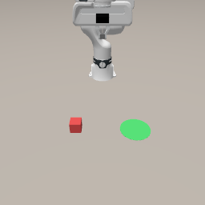
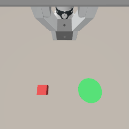

# VLA演習：ROS 2 × SmolVLA（データ収集 → 学習 → 実行 → 評価）

Gazebo 上の Franka FR3 で「赤いキューブを緑のゴールまで押す」タスクを題材に，
VLA（Vision-Language-Action）モデル SmolVLA のデータ収集から評価までの一連の流れを1コマ（90分）で体験する演習です．

| 正面カメラ（camera1） | 手首カメラ（camera2） |
|---|---|
|  |  |

```
[ローカルPC: Docker (ROS 2 Humble + Gazebo Fortress)]                          [Colab (GPU)]
 teleop_keyboard ──▶ rosbag ──▶ rosbag2lerobot ──▶ Hugging Face Hub ──▶ smolvla_finetune.ipynb
                                                          │                      │（モデルをHubへ）
                                                          ▼                      ▼
 Gazebo ◀── action_executor ◀── vla_client ◀──(HTTPS)── smolvla_server.ipynb (FastAPI + cloudflared)
   ▲                                                   
   └── evaluator（決められた初期配置で試行し，成功率を出す）
```

## 構成

```
vla_lecture/
├── franka_vla_sim/          # ROS 2 パッケージ（~/pai_ws/src に置く）
│   ├── config/task.yaml     # ★ 全体で共有する設定（fps・トピック・初期姿勢・評価条件）
│   ├── config/controllers.yaml
│   ├── urdf/fr3_vla.urdf.xacro   # franka_description の FR3 + 位置制御 + 手首カメラ
│   ├── worlds/push_cube.sdf      # キューブ・ゴール・正面カメラ
│   ├── launch/sim.launch.py      # Gazebo・コントローラ・ブリッジの起動
│   ├── launch/policy.launch.py   # 推論ノード + 実行ノードの起動
│   └── franka_vla_sim/
│       ├── teleop_keyboard.py    # 手先空間のキーボードテレオペ + エピソード記録
│       ├── vla_client.py         # 推論ノード：画像・関節角を API に送り action chunk を受け取る
│       ├── action_executor.py    # 実行ノード：action chunk を 10Hz でロボットに送る
│       ├── evaluator.py          # 評価ノード：成功率を計算して CSV に保存
│       ├── scripted_demo.py      # 【教員用】自動でデモを作って記録する
│       ├── kinematics.py         # URDF からの順運動学・逆運動学（numpy のみ）
│       └── common.py
├── pai_vla/                 # rosbag → LeRobotDataset 変換（pixi 環境）
│   ├── configs/conversion_config.yaml
│   └── scripts/rosbag2lerobot.py
├── notebooks/
│   ├── smolvla_finetune.ipynb    # Colab：SmolVLA のファインチューニング
│   └── smolvla_server.ipynb      # Colab：推論用 REST API（FastAPI + cloudflared）
├── server/smolvla_server.py      # 推論サーバ本体（ノートブックに埋め込み済み．GPU のある PC でも動く）
├── tests/teleop_key_driver.py    # テレオペの自動動作確認（キー入力を自動で送る）
└── docker/Dockerfile.test        # 教員の動作確認用（ヘッドレス）
```

## 設計のポイント（講義で説明する内容）

- **action = `/arm_controller/commands` に送った関節角の目標値（7次元）**，state = `/joint_states` の関節角（7次元）．
  テレオペも方策も同じトピックに同じ形式で送るので，学習時と実行時で行動の定義が一致する．
- **時刻の同期**：rosbag は `--use-sim-time` でシミュレーション時間で記録し，変換時に 10Hz の等間隔時刻で
  観測は「その時刻以前の最新値」，行動は「その時刻以降で最初の指令（観測を見た直後に送った指令）」を取る．
- **カメラ名**：データセットでは `observation.images.camera1`（正面）/ `camera2`（手首）．
  SmolVLA の事前学習モデル（`lerobot/smolvla_base`）の入力名に合わせてあるので，学習時に名前の変換が要らない．
- **action chunk**：SmolVLA は1回の推論で50ステップ（5秒分）の行動を出す．実行ノードはその先頭
  `n_action_steps`（既定10 = 1秒分）を実行してから次の推論を要求する（推論中はロボットは止まって待つ）．
- 推論ノードと実行ノードを分けてあるので，実機では実行ノードだけ差し替えればよい．

---

## 教員の事前準備

### 1. 教材の公開
`YOUR_ORG` となっている箇所（`pai_vla/configs/conversion_config.yaml`，2つのノートブック）を実際の組織名に置き換え，
このディレクトリを GitHub で公開する（以下では `https://github.com/YOUR_ORG/vla_lecture` とする）．

### 2. 配布データセットの作成（約20分 + 変換15分）
スクリプトのデモ（キューブの位置を見てゴール方向にまっすぐ押す）で50エピソードを自動生成する．成功したものだけ保存される．

```bash
ros2 launch franka_vla_sim sim.launch.py gui:=false          # ターミナルA
ros2 run franka_vla_sim scripted_demo --ros-args -p n_episodes:=50 -p use_sim_time:=true   # ターミナルB
cd ~/vla_lecture/pai_vla && pixi run convert --push           # repo_id を YOUR_ORG/franka_push にしておく
```

### 3. 配布モデルの学習
`notebooks/smolvla_finetune.ipynb` を `DATASET_REPO_ID = "YOUR_ORG/franka_push"`，
`MODEL_REPO_ID = "YOUR_ORG/smolvla_franka_push"` で実行する（A100 / L4 推奨）．
このとき **T4 での `updt_s`（1ステップの時間）とメモリ使用量も測っておき**，課題のステップ数・バッチサイズを決める．

### 4. 配布モデルの評価
自分の PC で推論サーバ（`python server/smolvla_server.py --model YOUR_ORG/smolvla_franka_push`，または Colab）を立て，
10試行の成功率を確認しておく（授業で「配布モデルは○%」と示す基準になる）．

```bash
ros2 launch franka_vla_sim policy.launch.py server_url:=http://localhost:8000
ros2 run franka_vla_sim evaluator --ros-args -p n_trials:=10 -p label:=distributed -p use_sim_time:=true
```

### 5. 救済用の推論サーバ
Colab が使えない学生のために，教員側でも推論サーバを1つ立てて URL を共有できるようにしておく．

---

## 学生の事前課題（授業前に必ず済ませる）

1. 前回までの Docker 環境（`airobotbook/ros2-desktop-ai-robot-book-humble`）が起動できること
2. Hugging Face アカウントを作り，**Write 権限のトークン**を発行しておく
3. 教材を取得してビルドし，pixi 環境を作っておく（ダウンロードが大きいので授業中にやらない）

```bash
cd ~ && git clone https://github.com/YOUR_ORG/vla_lecture.git
cd ~/pai_ws/src
git clone -b 2.9.0 https://github.com/frankaemika/franka_description.git
ln -s ~/vla_lecture/franka_vla_sim .
cd ~/pai_ws && rosdep install --from-paths src --ignore-src -r -y
colcon build --symlink-install --packages-select franka_description franka_vla_sim
source install/setup.bash

cd ~/vla_lecture/pai_vla && pixi install
huggingface-cli login   # pixi run huggingface-cli login でも可
```

4. 動作確認：`ros2 launch franka_vla_sim sim.launch.py` で FR3 とキューブが表示されること

---

## 授業当日の流れ（90分）

| 時間 | 内容 |
|---|---|
| 0–10 | 導入：VLA とは / 今日の流れ（上の図） |
| 10–30 | ① データ収集（テレオペで2〜3エピソード） |
| 30–40 | ② 変換・Hugging Face へアップロード |
| 40–50 | ③ Colab で学習を体験（loss が下がるのを確認したら止める） |
| 50–75 | ④ 配布モデルで推論サーバを立て，Gazebo で実行・評価（5試行） |
| 75–90 | 結果の共有・課題の説明 |

### ① データ収集

```bash
# ターミナルA：シミュレータ
ros2 launch franka_vla_sim sim.launch.py
# ターミナルB：テレオペ（このターミナルにフォーカスしてキー操作）
ros2 run franka_vla_sim teleop_keyboard --ros-args -p use_sim_time:=true
```

| キー | 動作 |
|---|---|
| W / S | 手先を前 / 後（+x / -x） |
| A / D | 手先を左 / 右（+y / -y） |
| R / F | 手先を上 / 下 |
| **N** | 新しいエピソード：キューブをランダムに置き直し，初期姿勢に戻ってから記録開始 |
| **M** | 記録を終了して保存（`~/dataset/rosbags/franka_push/ep_XXX`） |
| X | 記録を中止して破棄 |
| H | 記録せずにリセット（練習用） |
| Q | 終了 |

コツ：F で手先をキューブの高さまで下げ，キューブの「ゴールと反対側」に回り込んでから，ゴール方向へ押す．
記録した bag は `ros2 bag info ~/dataset/rosbags/franka_push/ep_000` で中身を確認できる．

### ② 変換・アップロード

`pai_vla/configs/conversion_config.yaml` の `repo_id` を `<自分のHFユーザー名>/franka_push` に変更してから：

```bash
cd ~/vla_lecture/pai_vla
pixi run convert --push
```

アップロードしたデータセットは https://huggingface.co/spaces/lerobot/visualize_dataset で可視化できる．

### ③ 学習の体験
`notebooks/smolvla_finetune.ipynb` を Colab で開き，`DATASET_REPO_ID` に配布データセットを指定して，
`STEPS = 200` 程度で 5 の学習セルまで実行する．loss が下がるのを確認したら止めてよい（本番の学習は課題で行う）．

### ④ 実行・評価
1. `notebooks/smolvla_server.ipynb` を Colab で開き（**③とは別のノートブック**），`MODEL_ID` を配布モデルにして上から実行する．
   最後に表示されるコマンドをコピーする．
2. ローカル PC で：

```bash
# ターミナルA：シミュレータ（起動したまま）
# ターミナルB：推論ノード + 実行ノード
ros2 launch franka_vla_sim policy.launch.py server_url:=https://xxxx.trycloudflare.com
# ターミナルC：評価（5試行．結果は ~/vla_eval/ に CSV で保存）
ros2 run franka_vla_sim evaluator --ros-args -p n_trials:=5 -p label:=distributed -p use_sim_time:=true
```

評価を使わずに1回だけ動かしてみるときは：

```bash
ros2 service call /vla/enable std_srvs/srv/SetBool "{data: true}"    # 開始
ros2 service call /vla/enable std_srvs/srv/SetBool "{data: false}"   # 停止
ros2 service call /vla/go_home std_srvs/srv/Trigger                  # 初期姿勢へ
```

---

## 課題（案）

1. 配布データセット（＋自分で集めたデータ）で SmolVLA をファインチューニングし，Hugging Face Hub に公開する．
2. 授業と同じ評価（`n_trials:=10`）で成功率を測り，配布モデルと比較する．
3. 発展：学習ステップ数・データ数・`n_action_steps` を変えたときの成功率の変化を考察する．
   / 言語指示を変えると挙動は変わるか？（例：タスク文を `-p task:="..."` で変えて `vla_client` を起動）

クラス全員のデータをまとめる場合（教員）：

```bash
lerobot-edit-dataset --new_repo_id YOUR_ORG/franka_push_class --operation.type merge \
  --operation.repo_ids "['user1/franka_push', 'user2/franka_push']"
```
（Hub へのアップロードなどのオプションは `lerobot-edit-dataset --help` を参照）

---

## トラブルシューティング

| 症状 | 対処 |
|---|---|
| コントローラの起動に失敗する | PC が遅いとシミュレーションの立ち上がりに時間がかかる．一度 Ctrl+C して起動し直す．`gui:=false` にすると軽くなる |
| テレオペのキーが効かない | テレオペのターミナルにフォーカスがあるか確認．`/robot_description 待ち` と出る場合はシミュレータが起動していない |
| 変換で「メッセージがありません」 | 記録開始直後に M を押した可能性．`ros2 bag info` で各トピックの Count を確認 |
| `推論サーバに接続できません` | Colab のセル 6 で表示された URL か確認．Colab のランタイムが切れていないか確認 |
| ロボットが動かない | `ros2 service call /vla/enable ...` したか．`vla_client` のログに `推論OK` が出ているか |
| 別の人の Gazebo / ROS と混線する | 同じネットワークの人と `ROS_DOMAIN_ID` を変える（例：`export ROS_DOMAIN_ID=学籍番号の下2桁`） |

---

## 動作確認の状況（2026-09-27 時点）

確認済み：
- ROS 2 Humble + Gazebo Fortress（arm64 の `ros:humble` と，学生用の `airobotbook/ros2-desktop-ai-robot-book-humble`（amd64 エミュレーション））で
  シミュレータ起動・コントローラ・カメラ2台・キューブ位置のトピック
- `scripted_demo` による自動デモ（成功率 100%，1エピソード約12秒）と rosbag 記録
- `rosbag2lerobot.py` による LeRobotDataset v3.0 への変換と読み込み（lerobot 0.6.1）
- `lerobot-train --policy.path=lerobot/smolvla_base` がこのデータセットで動くこと（数ステップのみ，Mac の MPS で確認）
- `teleop_keyboard` のキー操作（`tests/teleop_key_driver.py` で疑似端末からキーを送って確認）：
  N → キューブの横へ移動 → A で横に滑らせてゴールへ → M で保存（2/2 成功），X で破棄，H で記録なしリセット（学生用イメージ）
- `smolvla_server.py` の推論（50×7 の action chunk，MPS で約0.75秒）と，
  Gazebo → `vla_client` → API → `action_executor` → `evaluator` の一連のループ

未確認（事前準備で要確認）：
- **Colab（T4）での学習速度とメモリ使用量**，および学習済みモデルの成功率（GPU で十分なステップ数の学習をしていないため）
- Colab での `pip install` と cloudflared によるトンネル
- 学生用イメージでの `pixi install`（依存関係の解決までは確認．CPU 版 PyTorch の指定を入れた後のインストールは未確認）
- Gazebo の GUI 表示（`gui:=true`）．確認はすべて GUI なしで行った
